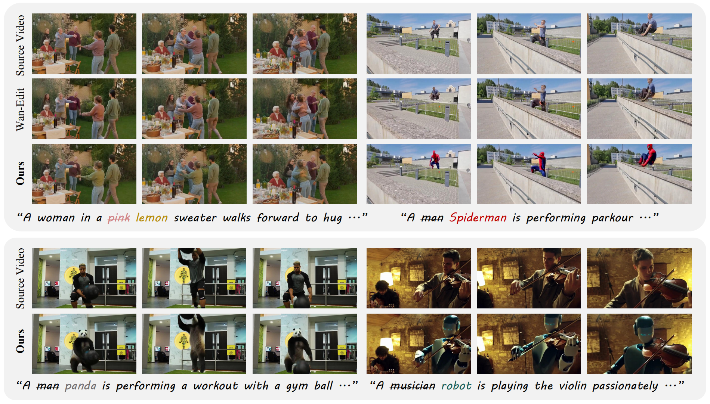

# FlowAnchor: Stabilizing the Editing Signal for Inversion-Free Video Editing

<div align="center">

<a href="https://cuc-mipg.github.io/FlowAnchor.github.io/"></a>
&nbsp;
<a href="https://arxiv.org/abs/2604.22586"></a>

</div>

## ✨ Overview



We propose **FlowAnchor**, a training-free framework for stable and efficient inversion-free video editing. Spatial-aware Attention Refinement (SAR) and Adaptive Magnitude Modulation (AMM) stabilize the editing signal for precise localization and sufficient editing strength.

## 📰 News

- **[2026/11]** We release the pipeline and inference code of **FlowAnchor**, along with our **Wan-Edit+Mask** implementation.
- **[2026/07]** Our paper **FlowAnchor** has been accepted by **ACM Multimedia 2026 (ACM MM 2026)**!
- **[2026/04]** Released our arXiv paper: [FlowAnchor: Stabilizing the Editing Signal for Inversion-Free Video Editing](https://arxiv.org/abs/2604.22586).

## 📝 To-Do List

- [x] ~~Release the pipeline and inference code of FlowAnchor.~~
- [x] ~~Release our implementation of Wan-Edit + mask.~~

## ⚙️ Environment Setup

```bash
git clone https://github.com/CUC-MIPG/FlowAnchor.git
cd FlowAnchor
conda create -n flowanchor python=3.10 -y
conda activate flowanchor
pip install torch==2.6.0 torchvision==0.21.0
pip install -r requirements.txt
# Download Wan2.1-T2V-1.3B-Diffusers, or use your local model via MODEL_PATH.
python scripts/download_models.py
```

## 🚀 Usage

Run the provided example:

```bash
bash scripts/run_hugging_lemon.sh
```

The edited video is saved to `outputs/hugging_lemon.mp4`.

Wan-Edit+Mask is provided in `src/wanedit_mask/`, with the inference entry at `scripts/edit_wanedit_mask.py`.

For your own videos, first use [SAM](https://github.com/facebookresearch/segment-anything) to segment the editing region in the first frame, then use [VACE](https://github.com/ali-vilab/VACE) to propagate the mask to subsequent frames. Run this command in the VACE repository, with `--mask` pointing to the first-frame mask:

```bash
python vace/vace_preproccess.py --task inpainting --mode masktrack \
  --mask assets/masks/test.png --video assets/videos/test.mp4
```

Convert the resulting mask video to PNG frames using `scripts/mask_video_to_frames.py`.

## 🙏 Acknowledgements

We thank the authors of [FlowEdit](https://github.com/fallenshock/FlowEdit), [VideoGrain](https://github.com/knightyxp/VideoGrain), and [UniEdit-Flow](https://github.com/DSL-Lab/UniEdit-Flow) for sharing their implementations with the community.

## 📖 Citation

If you find our work useful, please consider citing our paper.

```bibtex
@inproceedings{chen2026flowanchor,
  title={FlowAnchor: Stabilizing the Editing Signal for Inversion-Free Video Editing},
  author={Chen, Ze and Chen, Lan and Li, Yuanhang and Mao, Qi},
  booktitle={Proceedings of the 34th ACM International Conference on Multimedia},
  year={2026}
}
```
